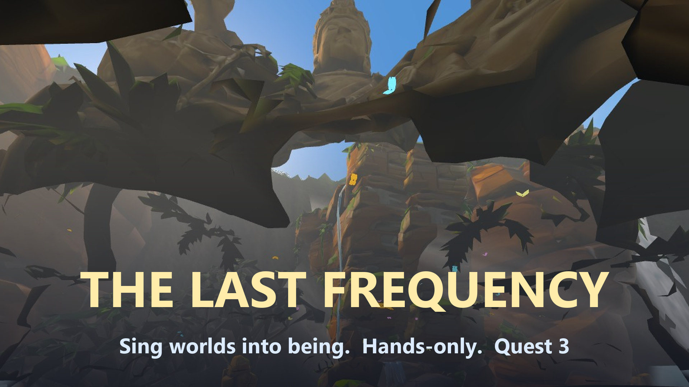

# THE LAST FREQUENCY
### Sing a world into being.

**A seated, hands-only VR musical for Meta Quest.** You sit in the dark. You sing. And the world, slowly, starts singing back.

*Meta VR Start Developer Competition 2026 · Entertainment track*

---

## Why this exists

Most of us stopped singing out loud a long time ago. We learned singing is for people who are "good at it", and the rest of us went quiet.

The Last Frequency is a place where your voice is not judged; it is **needed**. Hum, and a bud blooms. Hold a note, and a staircase climbs into the aurora. Sing high and the magic turns bright and quick; sing low and it turns deep and slow. Every sound you make leaves something behind.

People who say "I can't sing" are the people we built this for.

## What you do

- **Sing along** to an original song; the 360° world builds around you in waves timed to the music.
- **Your pitch shapes the magic**, and holding a note grows a spiral staircase.
- **Touch** wonder-buds to bloom them; **raise both hands** to conduct light; **pinch and draw** shapes in the air (rectangle = door of light, circle = snowflakes, triangle = crystal spires).
- **Jungle Temple** (second world and song): push to raise land, lift to pour waterfalls, push with both hands to grow stairs, then climb them.
- **COMPOSE**: a typed word becomes a song you play by touch. **LISTEN AND BUILD**: the world reacts to any music in your room.
- **Mixed reality**: your room becomes the stage. **Calm mode** and **no-mic mode** for comfort and access.
- **SAVE MY SONG** to a WAV on the headset; **SHARE TO PHONE** by QR code over your own Wi-Fi, nothing uploaded.

## Measured on a Meta Quest 3S
- Steady **72 fps** through a full on-device run (59 s at 72, 57 s at 73, 3 s at 71)
- Mixed reality passthrough working; microphone and both hands detected
- Whole app plays end to end with no exceptions

## Under the hood
Unity 6 · C# · URP · Meta XR SDK on OpenXR · 25 runtime scripts (~3,300 lines) and 24 custom shaders written for this project.

- **Real-time pitch tracking on the headset** (normalised square difference, ~73 Hz to 1.3 kHz). Synthetic sung notes C5-C6: 0% correct with the first tracker, 100% with this one.
- **Analysed song packs**: sections, beats, intensity, timed lyrics and guide melody (`Tools/analyze_song.py`, librosa).
- **Headless autopilot** that plays the whole real app for testing (`Assets/Scripts/LFAuto.cs`).

Details: [`JudgesPack/03_HOW_IT_WORKS.md`](JudgesPack/03_HOW_IT_WORKS.md) · honest status: [`JudgesPack/04_HONEST_STATUS.md`](JudgesPack/04_HONEST_STATUS.md) · the story: [`JudgesPack/01_STORY.md`](JudgesPack/01_STORY.md) · where it goes next: [`JudgesPack/05_WHATS_NEXT.md`](JudgesPack/05_WHATS_NEXT.md)

## Build it
1. Unity **6000.0.85f2** with Android build support.
2. Open this folder as a Unity project; open `Assets/Scenes/LastFrequency.unity`.
3. Build for Android (Meta Quest): menu **Last Frequency > Build Quest APK**, or headless:
   `Unity -batchmode -projectPath . -executeMethod LF.Editor.LFBuilder.BuildNamed -apkOut Builds/LastFrequency.apk`
4. Autopilot run: `-executeMethod LF.Editor.LFBuilder.Autopilot -lf-auto` (add `-lf-jungle` for the jungle).

Song generation scripts (`Audio/gen_song*.py`) read an ElevenLabs key from the `ELEVENLABS_API_KEY` environment variable only; no keys are stored in this repository.

## Credits and disclosure
Songs generated with ElevenLabs Music. Jungle meshes generated with Tripo, then cleaned, lit and assembled in Blender. AI coding assistants helped with the engineering. No third-party film, game or song material is included.

---

*The world went quiet. You are its last frequency.*

---

**Privacy policy:** https://theclazer.github.io/the-last-frequency/privacy.html · **Contact:** Rayyan Shaikh, therayyn16@gmail.com
